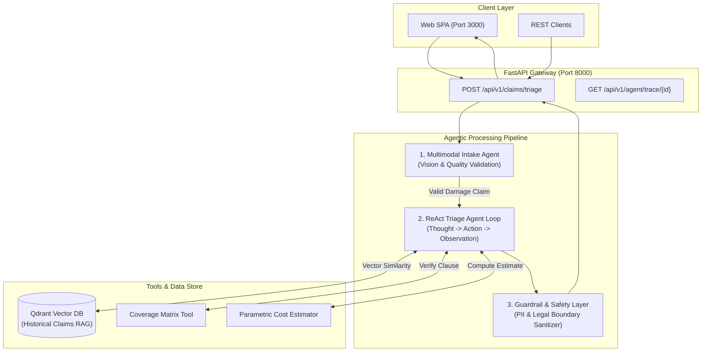

# ClaimSense AI 🛡️

> **Autonomous Multimodal Insurance Claim Triage & Damage Assessment Platform**  
> Built with **FastAPI**, **Qdrant Vector DB**, **ReAct Agent Architecture**, and **Docker**.

[](https://python.org)
[](https://fastapi.tiangolo.com)
[](https://qdrant.tech)
[](https://docker.com)
[](#agent-architecture)

---

## 📌 Executive Summary

**ClaimSense AI** is an enterprise-grade agentic system designed to streamline and automate property damage claim triage for insurance companies. Traditional claim intake requires manual inspection by adjusters, taking days to validate coverage and schedule repairs.

ClaimSense AI ingests **damage photographs**, **policy documents (PDFs)**, and **claim descriptions** to generate a verified triage assessment in under 20 seconds. It autonomously:
1. Validates physical damage and flags non-property/fraudulent submissions via **Multimodal Vision**.
2. Executes a **ReAct (Reasoning + Acting) Agent Loop** to query historical claims via **Dense Vector Retrieval (RAG)**, verify coverage tables, and compute parametric repair estimates.
3. Applies **Safety Guardrails** to sanitize PII, prevent biased decisions, and ensure outputs never make premature legal commitments.

---

## 🏗️ System Architecture



---

## 🌟 Key Capabilities

### 1. Multimodal Intake & Property Validation
- Evaluates damage images using visual reasoning models.
- Rejects non-property images, low-quality photos, or cases with no visible damage before triggering heavy processing.
- Automatically extracts affected areas (e.g., kitchen, bathroom) and damage categories (water, fire, structural).

### 2. Autonomous ReAct Agent Loop
- Operates under the **Reasoning + Acting** paradigm:
  - **Reason**: Formulates a hypothesis and identifies required information.
  - **Act**: Executes specialized tools deterministically (`search_past_claims`, `check_coverage`, `estimate_repair_cost`).
  - **Observe**: Integrates tool outputs back into the reasoning context to arrive at the final payout recommendation.

### 3. Dense Retrieval (RAG) with Qdrant
- Uses **FastEmbed** (`BAAI/bge-small-en-v1.5`, 384 dimensions) to index historical claim records into Qdrant.
- Retrieves top-$k$ nearest past incidents using cosine similarity to establish precedent-based severity estimation.

### 4. Enterprise Output Guardrails
- **PII Scrubbing**: Detects and redacts personal names, phone numbers, and addresses.
- **Legal Boundaries**: Ensures recommendations state that the assessment is subject to on-site adjuster verification.
- **Consistency Verification**: Cross-references identified affected rooms with parametric itemized repair costs to prevent hallucinated totals.

---

## 🚀 Quick Start

### Prerequisites
- [Docker](https://www.docker.com/) & Docker Compose
- API Key for OpenAI or any OpenAI-compatible provider

### 1. Clone & Configure
```bash
git clone https://github.com/your-username/ClaimSense-AI.git
cd ClaimSense-AI
cp .env.example .env
```

Edit `.env` with your API credentials:
```env
OPENAI_API_KEY=your_api_key_here
OPENAI_BASE_URL=https://api.openai.com/v1
LLM_MODEL=gpt-4o
QDRANT_URL=http://qdrant:6333
```

### 2. Launch with Docker Compose
```bash
docker compose up -d --build
```

### 3. Access Services
- **Web Interface**: [http://localhost:3000](http://localhost:3000)
- **FastAPI Backend**: [http://localhost:8000](http://localhost:8000)
- **Interactive Swagger Docs**: [http://localhost:8000/docs](http://localhost:8000/docs)
- **Qdrant Vector Dashboard**: [http://localhost:6333/dashboard](http://localhost:6333/dashboard)

---

## 📡 API Reference

### `POST /api/v1/claims/triage`
Submits a new property claim for intake validation and autonomous triage.

**Form Data / Multipart:**
- `photos`: One or more image files (`.jpg`, `.png`).
- `description`: Text description of the incident.
- `policy_type`: Policy tier (`HO-3`, `HO-4`, `HO-5`, etc.).
- `policy_document` *(optional)*: PDF document containing endorsement details.

**Response Structure:**
```json
{
  "claim_id": "CLM-A89F31",
  "status": "completed",
  "triage_assessment": {
    "damage_type": "water",
    "severity": "moderate",
    "affected_areas": ["kitchen"],
    "recommended_action": "dispatch_contractor",
    "is_covered": true,
    "cost_estimate": {
      "min": 1800,
      "max": 3200,
      "currency": "EUR"
    },
    "reasoning": "Visible water damage on lower drywall consistent with burst pipe incident. Historical precedent CLM-2024-004 confirms coverage under standard HO-3 policy."
  },
  "guardrail_checks": {
    "pii_detected": false,
    "legal_boundaries_enforced": true,
    "output_sanitized": true
  }
}
```

### `GET /api/v1/agent/trace/{claim_id}`
Returns the granular step-by-step reasoning trace executed by the ReAct agent, including intermediate tool calls and observations.

---

## 📂 Repository Structure

```text
ClaimSense-AI/
├── backend/
│   ├── agents/
│   │   ├── intake.py          # Multimodal intake validator (Vision LLM)
│   │   ├── triage.py          # ReAct Agent loop & tool orchestrator
│   │   └── safety.py          # Two-way output guardrails & PII filter
│   ├── main.py                # FastAPI endpoints & lifecycle
│   ├── vector_store.py        # Qdrant client & FastEmbed vectorizer
│   ├── tools.py               # Deterministic business tools (coverage & cost)
│   ├── llm_client.py          # Resilient OpenAI client with header management
│   ├── config.py              # Configuration & environment loader
│   ├── requirements.txt       # Python dependencies
│   └── Dockerfile             # Production backend container
├── frontend/
│   ├── index.html             # Responsive dashboard & claim submission UI
│   ├── styles.css             # Dark theme design system
│   ├── app.js                 # Trace inspector & API client
│   ├── nginx.conf             # Nginx reverse proxy configuration
│   └── Dockerfile             # Frontend container
├── data/                      # Knowledge base claims & reference tables
├── tools/                     # Parametric cost & coverage JSON lookups
├── docker-compose.yml         # Multi-service composition
└── Makefile                   # Developer productivity commands
```

---

## 🛡️ License

This project is licensed under the MIT License.
